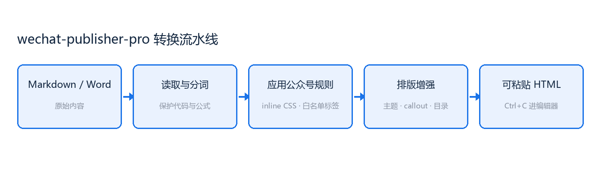

# 这份样例的用途

这篇文章不是给你读的，是给你**跑**的。它把 wechat-publisher-pro 的每一项能力都用了至少一次，所以只要它能干净地转换出来，说明整条流水线是通的。

> [!NOTE] 怎么用它
> 在 skill 目录下运行 `python scripts/convert_to_wechat.py examples/sample_article.md out.html`，然后在浏览器里打开 `out.html` 对照本文件检查渲染结果。

## 主题系统

同一份 Markdown，换个主题就是另一种气质。内置六套：

| 主题 | 气质 | 适合 |
|---|---|---|
| `default` | 中性灰蓝 | 通用 |
| `accent` | 蓝调清晰 | 技术、产品 |
| `warm` | 暖阳橙 | 随笔、心得 |
| `minimal` | 黑白留白 | 学术、严肃 |
| `tech` | 终端绿 | 开发者向 |
| `ink` | 墨韵红 | 中文书卷气 |

切换只需要一个参数：

```bash
python scripts/convert_to_wechat.py article.md out.html --theme ink
```

你也可以只改主色，不动其它：

```bash
python scripts/convert_to_wechat.py article.md out.html --accent "#0f766e"
```

### 主题是怎么生成的

标题的样式不是写死的，而是从调色板推导出来的。改一个 `accent`，左色条、表格表头、引用边框、目录底色会一起变——因为它们都指向同一个色值。

## Callout 框

用 GitHub 的 alert 语法写提示框，转换后是带边框和底色的方框：

> [!NOTE] 知识点
> 公众号编辑器只认 inline CSS，因为它在粘贴时会丢掉 `<style>` 标签和全部 class 属性。

> [!TIP] 提示
> 写框的时候直接在 `>` 后面写 `[!TIP] 自定义标题` 就能覆盖默认标题。

> [!WARNING] 注意
> 表格超过 5 列在手机上会挤成一团，脚本会提醒你拆分。

> [!DANGER] 警告
> SVG 图片在保存到公众号时会直接消失，这是平台行为，不是脚本的 bug。

> [!KEY] 核心
> 输入 Markdown，输出可直接粘贴的公众号 HTML。一句话说不清输入输出的技能，都还不够聚焦。

> [!SUCCESS] 结论
> 六种提示框共用一套语义配色：提示永远是绿的，警告永远是琥珀色——换主题也不会串味。

## 数学公式

行内公式写成 $E = mc^2$，它会渲染成一张透明 PNG 嵌进正文，跟文字基线对齐。

独立成行的公式会居中显示：

$$
\sum_{i=1}^{n} \left( x_i - \bar{x} \right)^2
$$

复杂一点的也没问题：

$$
\bar{x} = \frac{1}{n}\sum_{i=1}^{n} x_i, \qquad
\sigma^2 = \frac{1}{n}\sum_{i=1}^{n}(x_i - \bar{x})^2
$$

> [!NOTE] 为什么要转成图片
> 公众号不支持 MathML、KaTeX，也会丢掉内联 SVG，唯一能在「粘贴 → 保存 → 发布」全流程活下来的公式载体就是 base64 PNG。

## 代码块

带语言标记的代码块会自动做语法高亮，颜色以内联样式写进每个 token：

```python
def convert(source: Path, theme: str = "accent") -> str:
    """把 Markdown 转成公众号 HTML。"""
    options = Options(theme=theme, toc="auto")
    preview, fragment, report, meta = render_document(source, options)
    if report.errors:
        raise RuntimeError(report.errors[0])
    return fragment
```

不带语言的代码块按纯文本处理：

```
$ python scripts/convert_to_wechat.py article.md out.html --theme ink
$ open out.html
```

## 图片与图注



图片的 alt 文本如果像一句话，就会被渲染成图注（像上面那张）；如果像文件名（`cover.png`），就会被忽略——写文件名的次数远多于写图注。

本地图片会被读成 base64 内嵌，粘贴到公众号后自动进入图库，不会因为路径失效而丢图。

## 中文排版

这一段的原文里，"用Python写第3个脚本" 是连在一起写的，转换后会自动加上空格：用Python写第3个脚本。三个半角点号会被规范成一个中文省略号。

> [!TIP] 标点强度可调
> 默认 `safe` 只处理省略号和全角空格这类无歧义的情况；如果你想连半角逗号也一起转，加 `--punct aggressive`。

## 目录与页脚

这篇文章的标题数超过了阈值，所以顶部自动生成了目录。目录条目**故意不带跳转链接**——公众号会剥掉 `id` 属性，锚点在发布后必然失效，留一个点了没反应的链接比没有链接更糟。

页脚在 front matter 里用 `footer:` 覆盖，不写就根据作者名生成一行版权声明。

---

## 关于限制

- 代码块不支持横向滚动（公众号没有这个能力），超长行会被折行
- Callout 框内部不支持嵌套代码块
- 单篇正文超过两万字会收到提醒

这些不是脚本的偷懒，是平台的边界。把边界写进提示信息里，比让用户发布后才发现要好。
